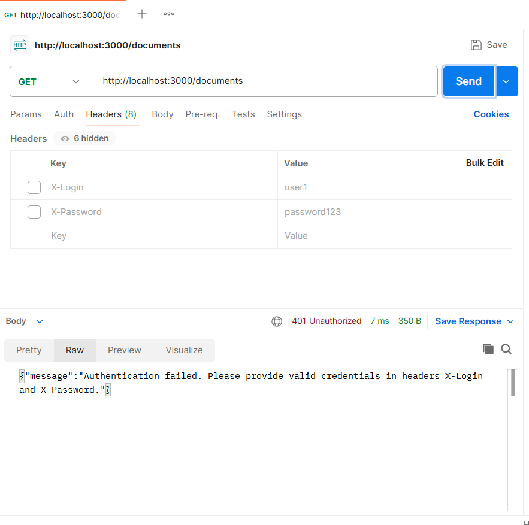
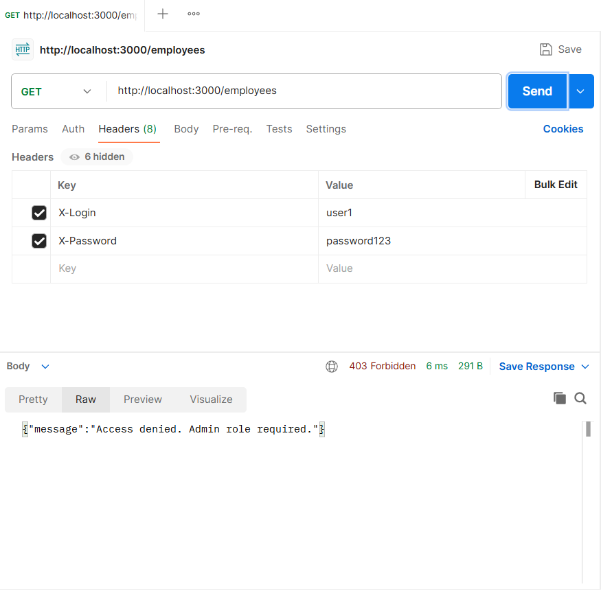
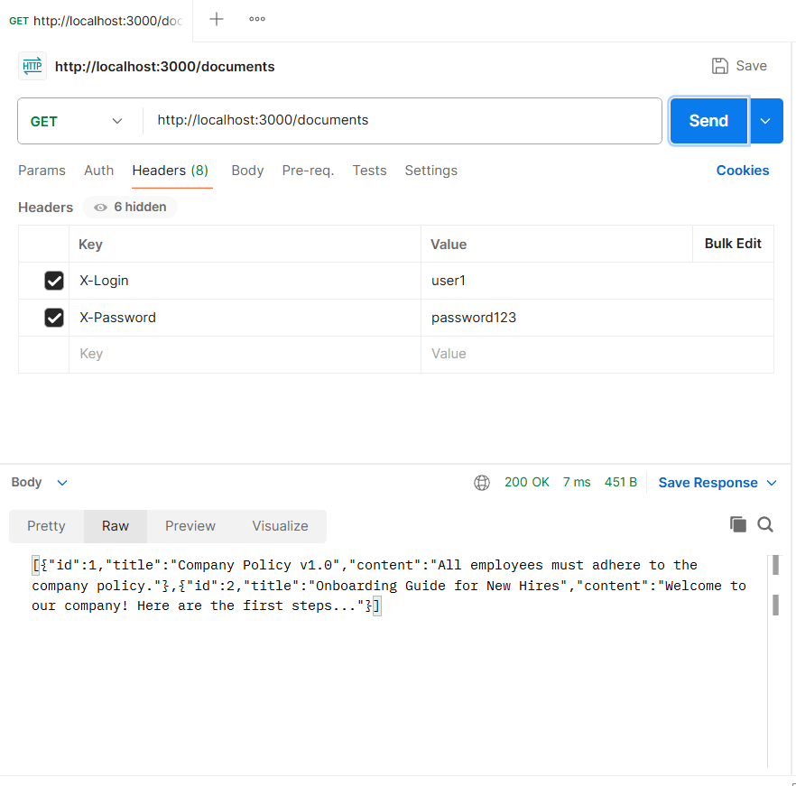
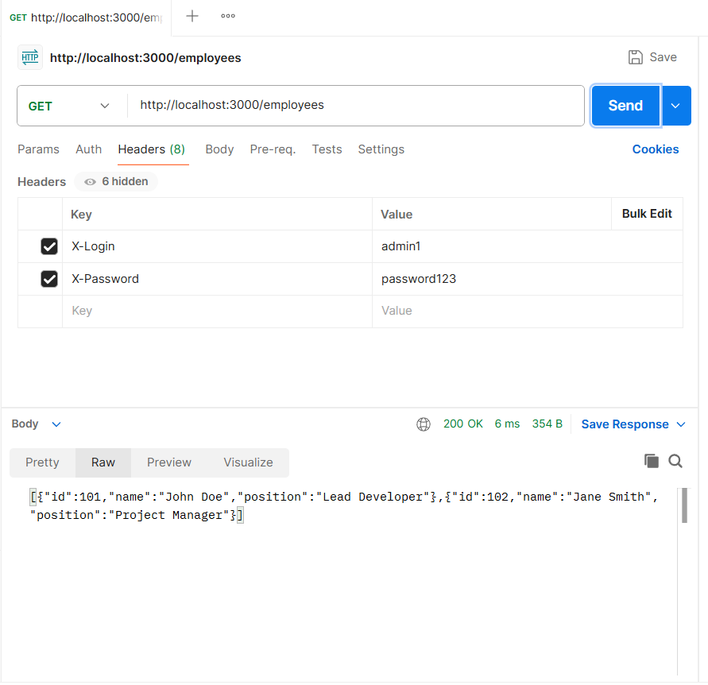
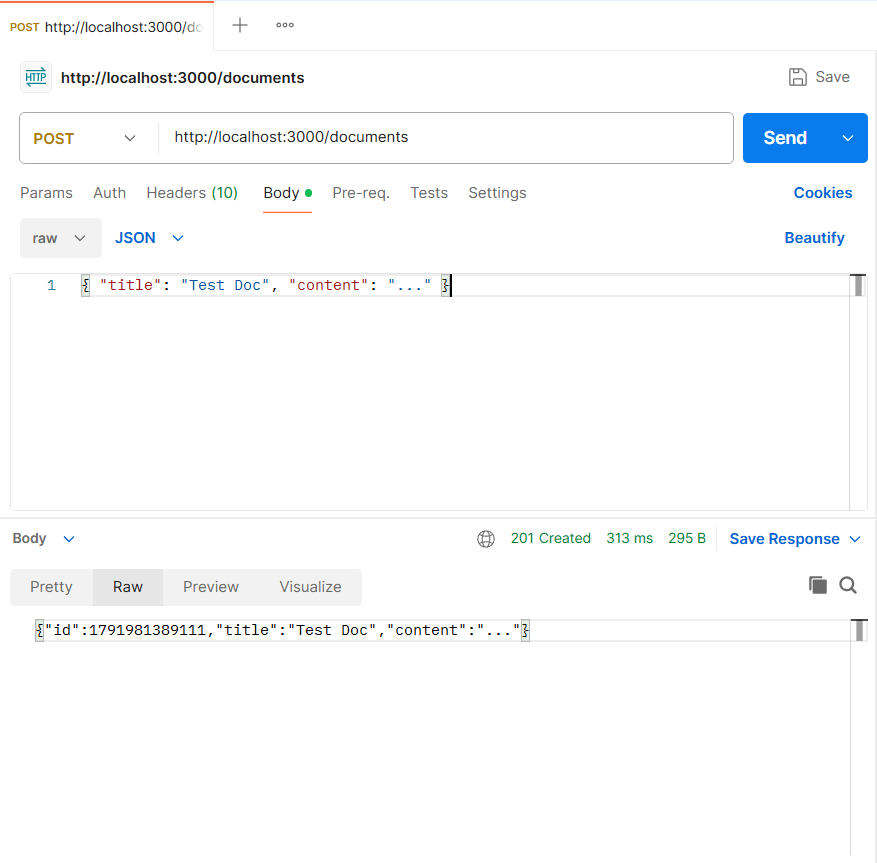
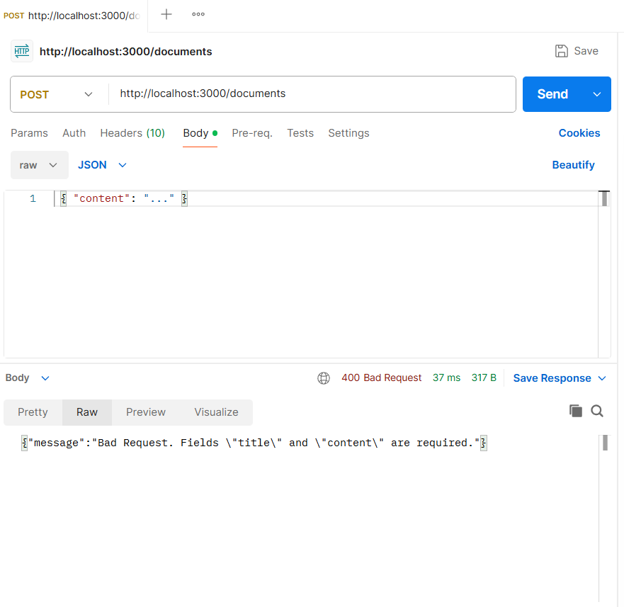
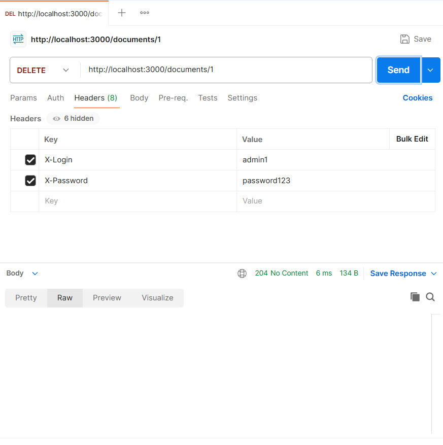
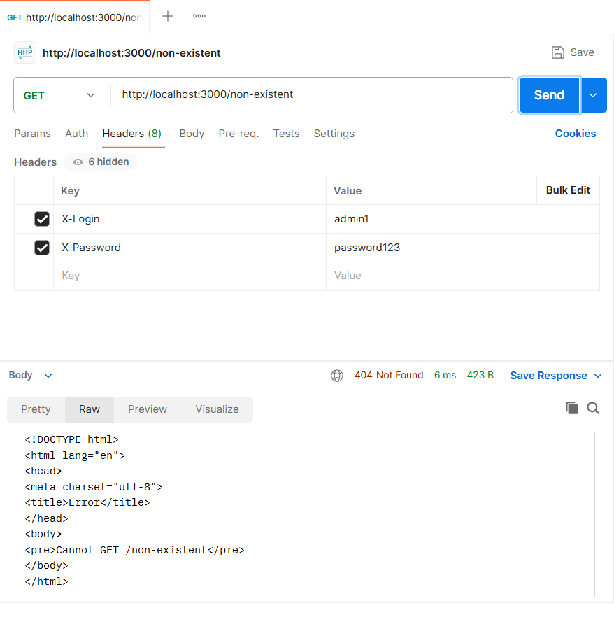

# secure-api-lab

REST API на Node.js та Express для керування документами та списком співробітників. Сервер реалізує аутентифікацію (логін і пароль у заголовках запиту), авторизацію за ролями (user та admin) та логування кожного запиту в консоль.

Усі дані (користувачі, документи, співробітники) зберігаються в пам'яті в модулі data.js, тому після перезапуску сервера вони повертаються до початкового стану.

## Встановлення та запуск

    npm install
    npm start

Сервер буде доступний за адресою http://localhost:3000

## Запуск тестового клієнта

Сервер має бути запущений в іншому вікні терміналу:

    npm test

## Аутентифікація

Для захищених ендпоінтів потрібні заголовки:

- X-Login — логін користувача
- X-Password — пароль користувача

Тестові користувачі: user1 (роль user) та admin1 (роль admin), пароль для обох password123.

## Ендпоінти

| Метод і URL | Опис | Заголовки | Тіло запиту | Коди відповіді |
|---|---|---|---|---|
| GET /documents | Список усіх документів | X-Login, X-Password | — | 200 — успіх; 401 — невірні або відсутні дані для входу |
| POST /documents | Створення документа | X-Login, X-Password | { "title": "Test Doc", "content": "..." } | 201 — створено; 400 — немає title або content; 401 — не автентифіковано |
| DELETE /documents/:id | Видалення документа за id | X-Login, X-Password | — | 204 — видалено; 401 — не автентифіковано; 404 — документ не знайдено |
| GET /employees | Список співробітників (тільки admin) | X-Login, X-Password (роль admin) | — | 200 — успіх; 401 — не автентифіковано; 403 — недостатньо прав |

Запит до неіснуючого маршруту повертає 404.

## Скріншоти тестування в Postman

1. GET /documents без заголовків — 401 Unauthorized

2. GET /employees від user1 — 403 Forbidden

3. GET /documents від user1 — 200 OK

4. GET /employees від admin1 — 200 OK

5. POST /documents — 201 Created

6. POST /documents без title — 400 Bad Request

7. DELETE /documents/1 — 204 No Content

8. GET /non-existent — 404 Not Found

## Репозиторій

https://github.com/FLEI-byte/secure-api-lab

## Звіт про виконная роботи

Детальний покроковий звіт про виконання кожного етапу (команди, результати, скріншоти):

[report.md](report.md)

