# Лабораторно-практична робота №3

**на тему:** "Розробка та тестування захищеного REST API на Node.js та Express."

**Мета:** Закріплення теоретичних знань та набуття практичних навичок з розробки, захисту та тестування серверних додатків на базі REST архітектури.

---

## Етап 1. Підготовка проєкту та середовища

1. Створення репозиторію

   Створено репозиторій `secure-api-lab` з опцією "Add .gitignore" та шаблоном "Node".

   URL репозиторію: https://github.com/FLEI-byte/secure-api-lab

   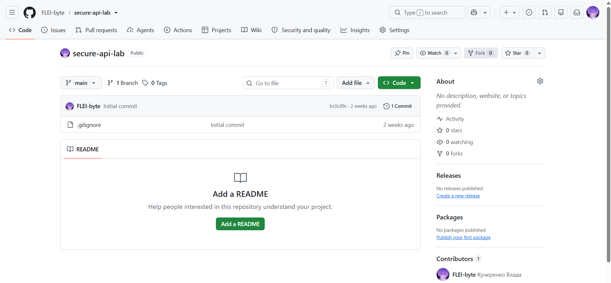

---

2. Клонування репозиторію та перехід у теку проєкту

   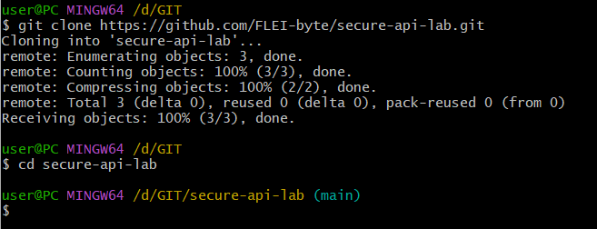

---

3. Ініціалізація Node.js проєкту

   Ініціалізовано проєкт за допомогою менеджера пакетів npm. Ця команда автоматично створила файл `package.json`.

   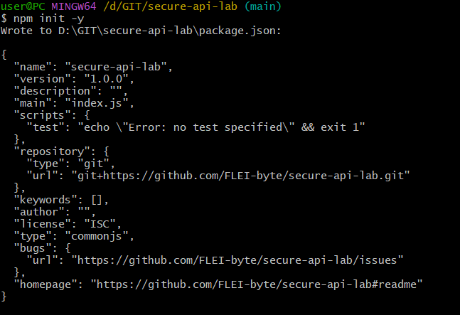

---

4. Встановлення Express

   У проєкт додано фреймворк Express. Він буде основою мого сервера.

   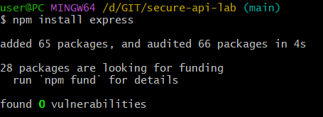

   Після виконання цієї команди з'явилася директорія `node_modules` та файл `package-lock.json`.

---

5. Створення базового вебсервера

   Створено у кореневій теці проєкту файл `server.js` та додано код. Перевірено, що файл створився.

   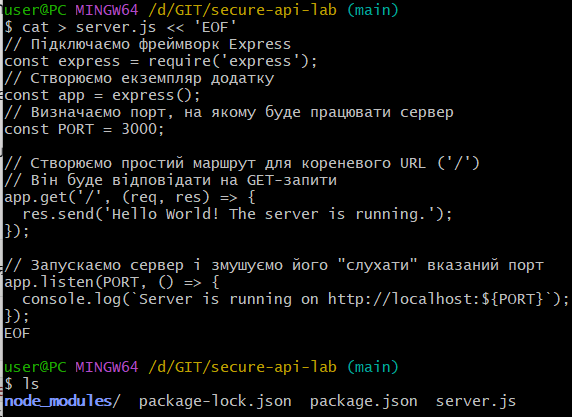

---

6. Перевірка роботи сервера

   Запущено сервер командою `node server.js`. У консолі з'явилося повідомлення: Server is running on http://localhost:3000.

   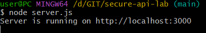

   Відкрито браузер і виконано перехід за адресою http://localhost:3000. На сторінці відображається текст "Hello World! The server is running."

   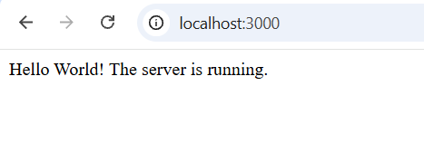

---

7. Збереження результатів у Git

   Збережено результати першого етапу, зроблено коміт та відправлено зміни на GitHub.

   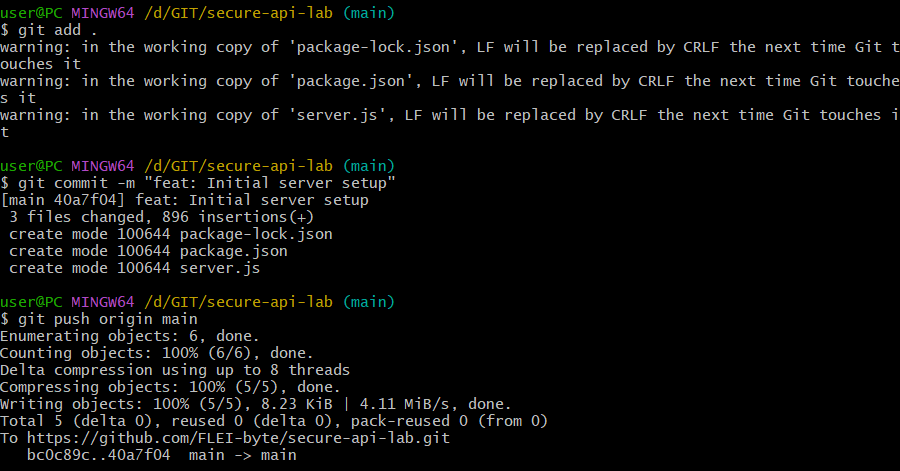

**Результат етапу:** створено готовий до подальшої розробки проєкт на GitHub, в якому налаштовано Express та запущено базовий вебсервер.

---

## Етап 2. Реалізація базового API та даних

1. Створення файлу з даними

   Щоб не захаращувати основний файл сервера, було створено окремий файл для зберігання даних. У корені проєкту створено файл `data.js` та додано до нього наступний вміст:

   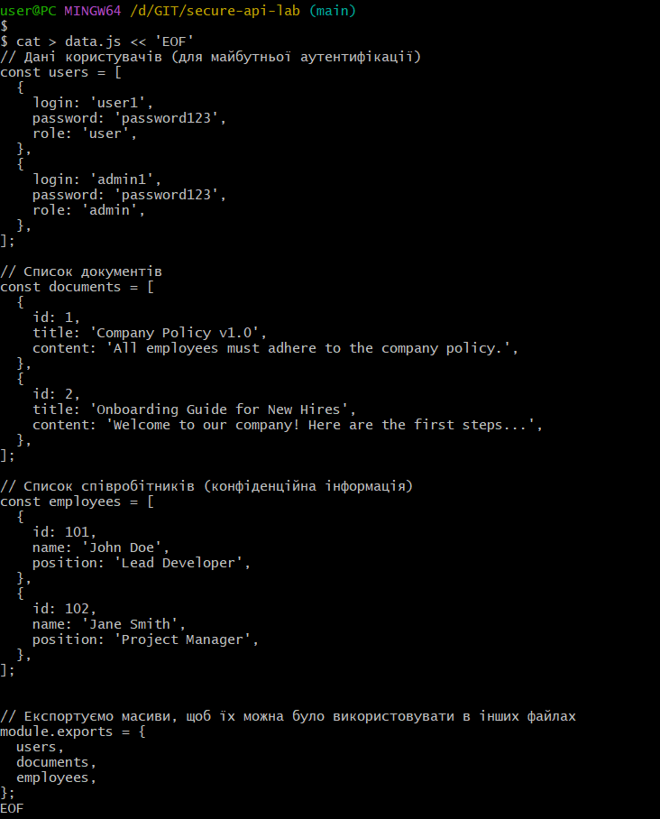

   Перевірка створення файлу:

   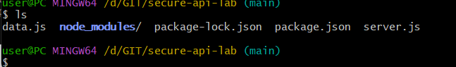

---

2. Модифікація файлу `server.js`

   Підключено дані до основного файлу сервера та додано необхідний middleware для роботи з JSON.

   Оновлення `server.js`:

   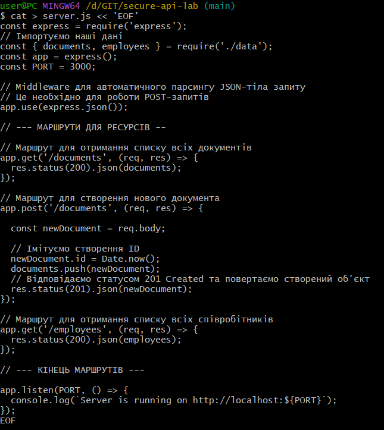

   Запуск сервера:

   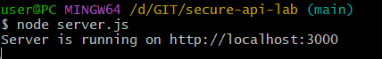

---

3. Перевірка роботи ендпоінтів за допомогою Postman

   Перезапущено сервер (`node server.js`). Відкрито Postman і перевірено наступні запити:

   - `GET http://localhost:3000/documents`: у відповідь отримано JSON-масив із двома документами та статус 200 OK.

     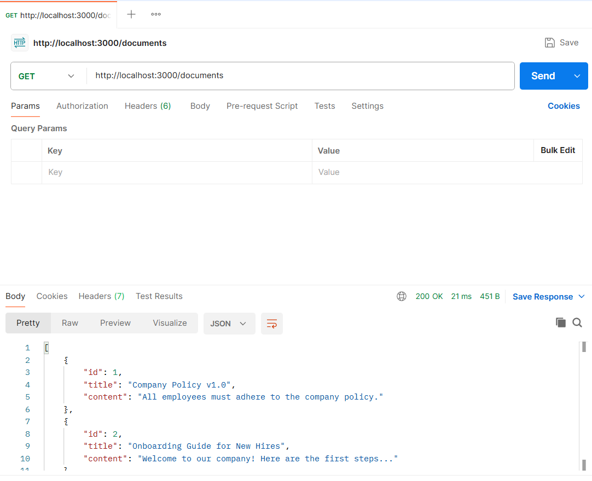

   - `GET http://localhost:3000/employees`: у відповідь отримано JSON-масив із двома співробітниками та статус 200 OK.

     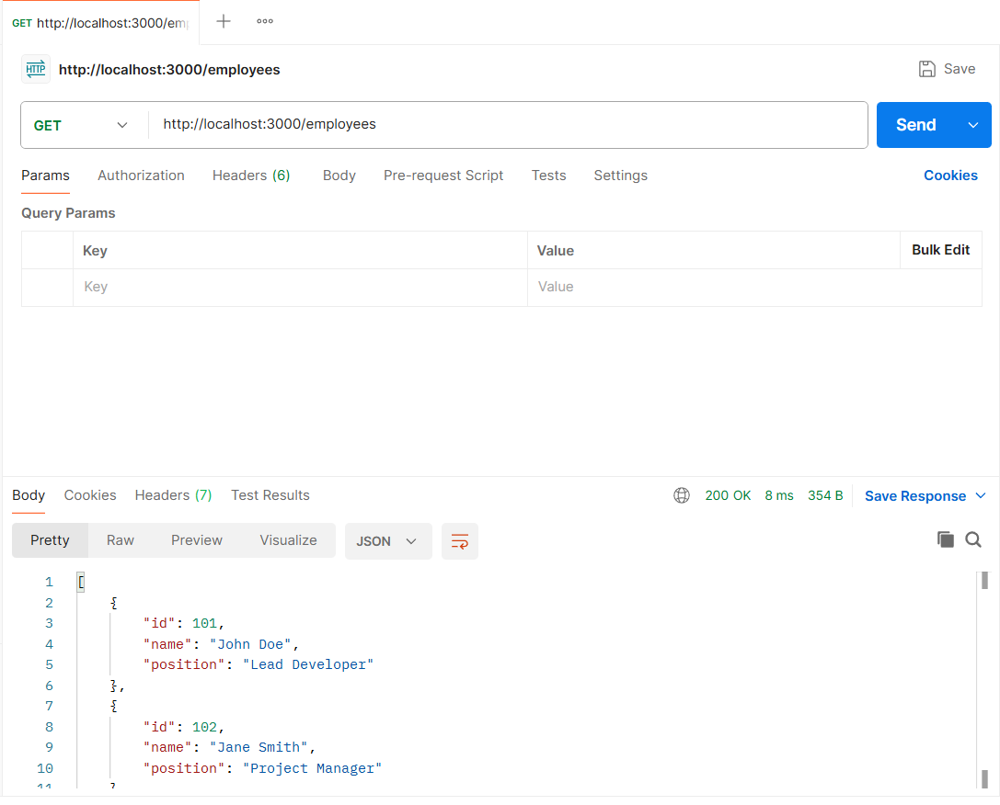

   - `POST http://localhost:3000/documents`: встановлено метод запиту **POST**, на вкладці **Body** обрано режим **raw** та тип **JSON**. У тіло запиту вставлено наступний JSON:

     {
       "title": "Q3 Financial Report",
       "content": "The financial results for Q3 are positive."
     }

     Запит надіслано. У відповідь отримано статус 201 Created та JSON-об'єкт нового документа з доданим полем `id`.

     Ще раз зроблено GET запит на `/documents`, щоб переконатись, що новий документ додався до списку:

     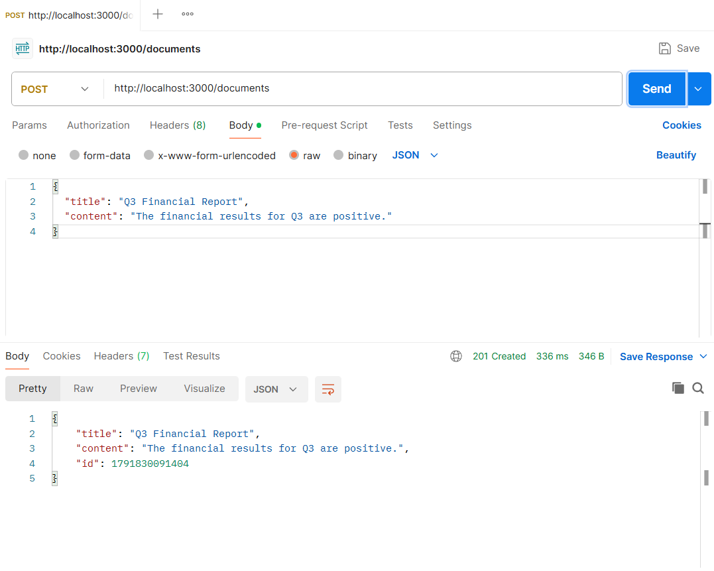

---

4. Збереження результатів у Git

   Зроблено коміт зі всіма змінами та відправлено їх на GitHub.

   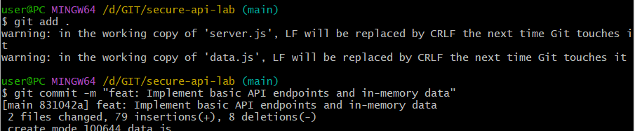

   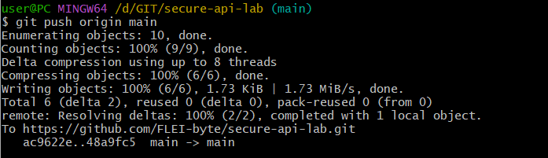

**Результат етапу:** сервер тепер має робочі ендпоінти для отримання та створення даних. Поки що вони відкриті для всіх, але на наступному етапі це буде виправлено.

---

## Етап 3. Реалізація безпеки (Аутентифікація та Авторизація)

**Кроки 1–3.** Створення та застосування middleware:

- Створено middleware для аутентифікації (`authMiddleware`). Функція перевіряє, чи надав користувач коректні логін та пароль у заголовках запиту.
- Створено middleware для авторизації (`adminOnlyMiddleware`). Функція перевіряє, чи має аутентифікований користувач роль admin.
- Middleware застосовано до маршрутів: перевірки "вбудовано" у ланцюжок обробки запитів для кожного маршруту. Middleware передаються як аргументи до `app.get()`, `app.post()` тощо перед основним обробником.

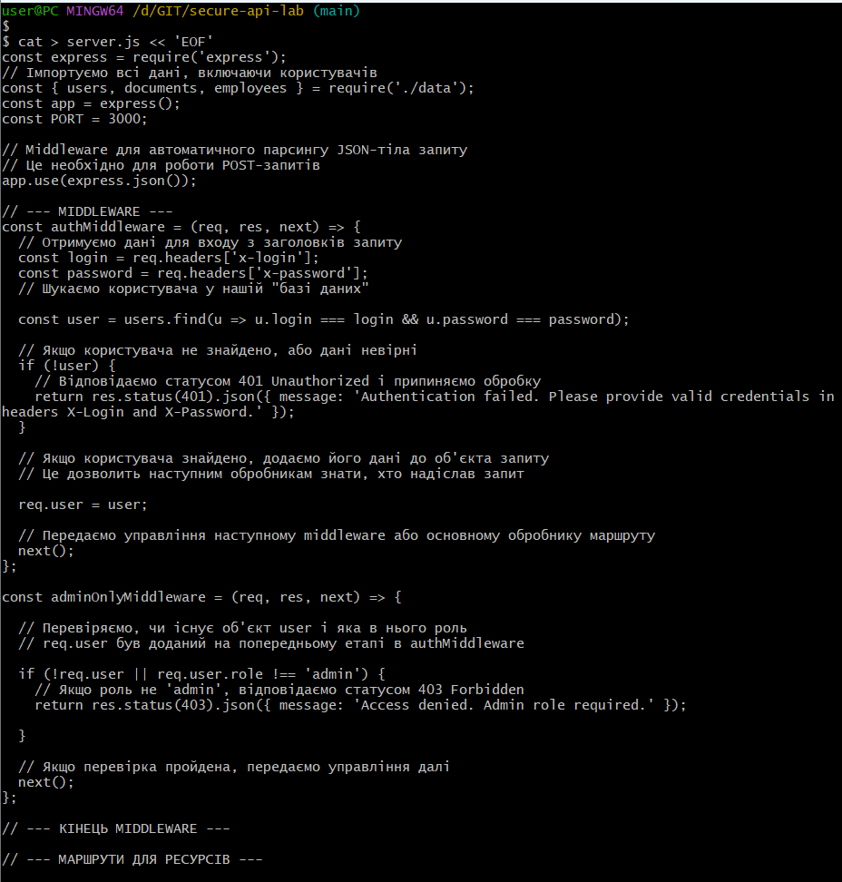

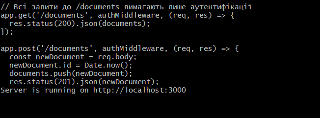

---

4. Тестування захищених ендпоінтів

   Перезапущено сервер (`node server.js`). Відкрито Postman і перевірено наступні сценарії.

   **Сценарій 1 (немає доступу):**

   Зроблено GET запит на http://localhost:3000/documents без заголовків.

   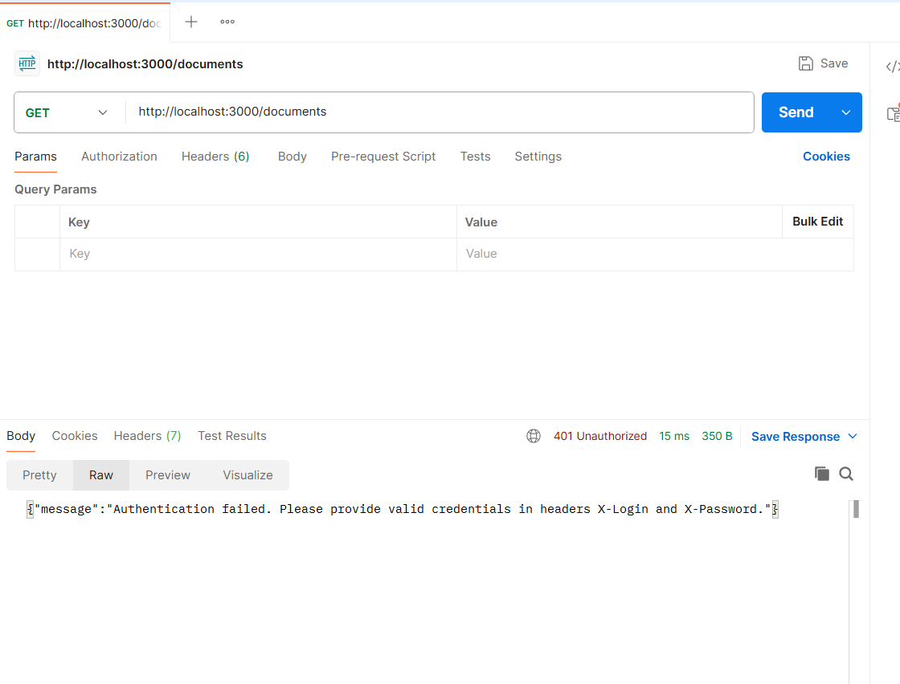

   **Результат:** статус 401 Unauthorized.

   **Сценарій 2 (доступ для user):**

   Зроблено GET запит на http://localhost:3000/documents. На вкладці Headers додано два заголовки: `X-Login` зі значенням `user1` та `X-Password` зі значенням `password123`.

   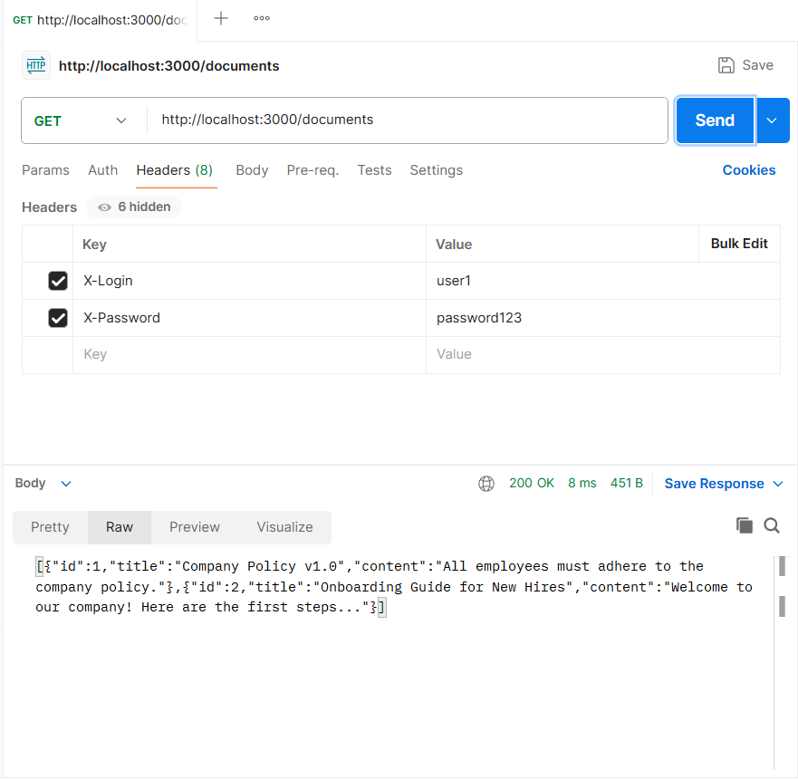

   **Результат:** статус 200 OK та список документів.

   **Сценарій 3 (заборона доступу для user):**

   Зроблено GET запит на http://localhost:3000/employees з тими самими заголовками (user1).

   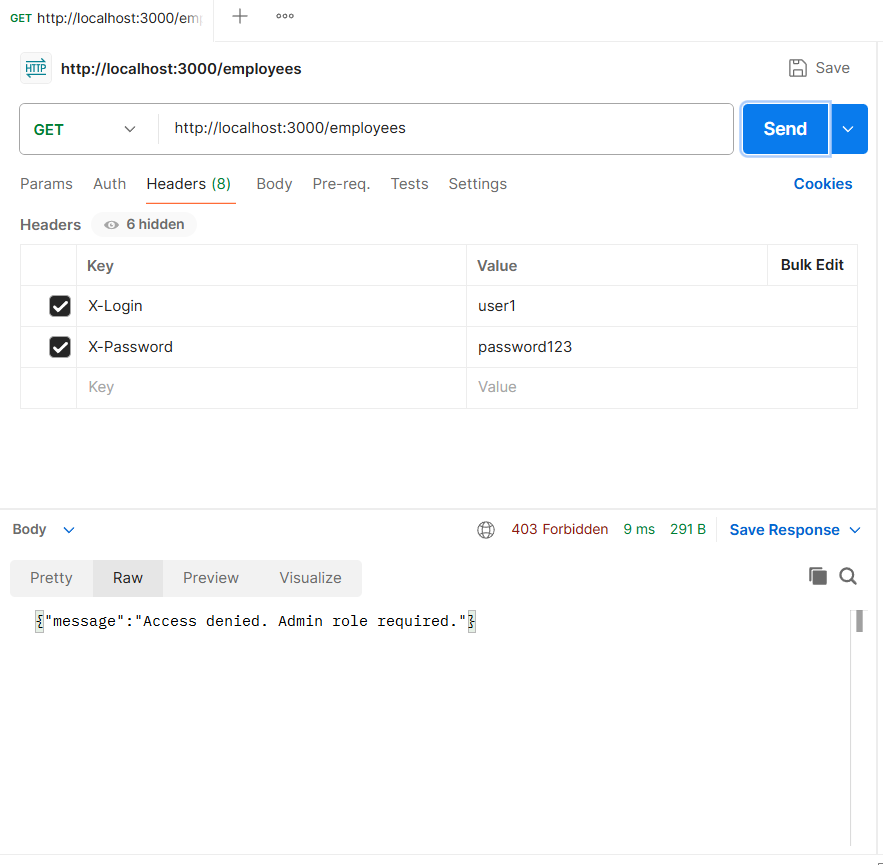

   **Результат:** статус 403 Forbidden.

   **Сценарій 4 (доступ для admin):**

   Зроблено GET запит на http://localhost:3000/employees. Змінено значення заголовків: `X-Login` на `admin1`, `X-Password` на `password123`.

   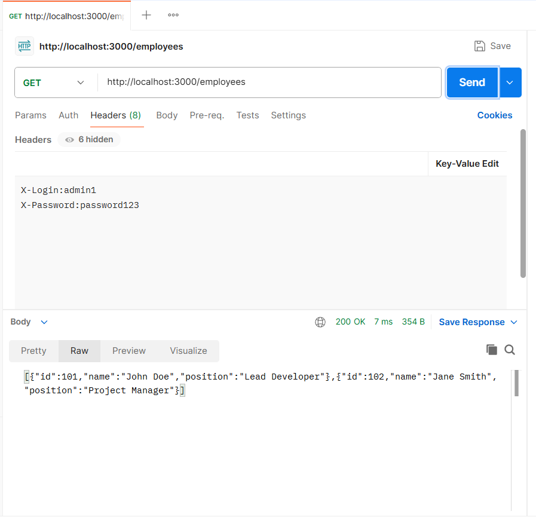

   **Результат:** статус 200 OK та список співробітників.

---

5. Збереження результатів у Git

   Зроблено коміт зі всіма змінами та відправлено їх на GitHub.

   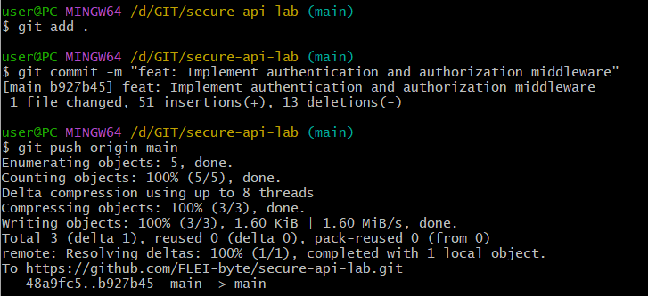

**Результат етапу:** API тепер захищене. Доступ до ресурсів надається тільки аутентифікованим користувачам, а до конфіденційних даних тільки адміністраторам.

---

## Етап 4. Реалізація логування

**Кроки 1–2.** Створення middleware для логування (`loggingMiddleware`)

Ця функція фіксує дані про запит і передає його далі по ланцюжку.

Код додано у файл `server.js` разом з middleware (перед розділом з маршрутами). Також у `server.js` після `app.use(express.json());` і перед першим маршрутом додано новий рядок, щоб логер працював для всіх запитів:

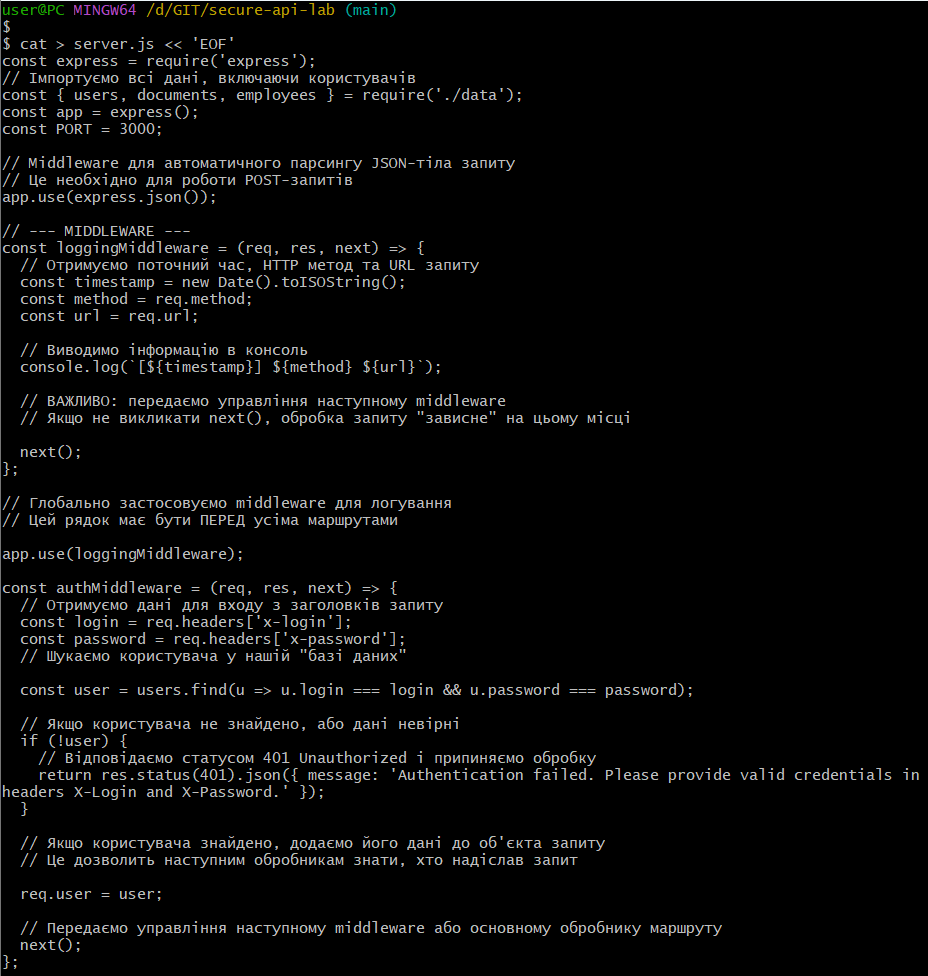

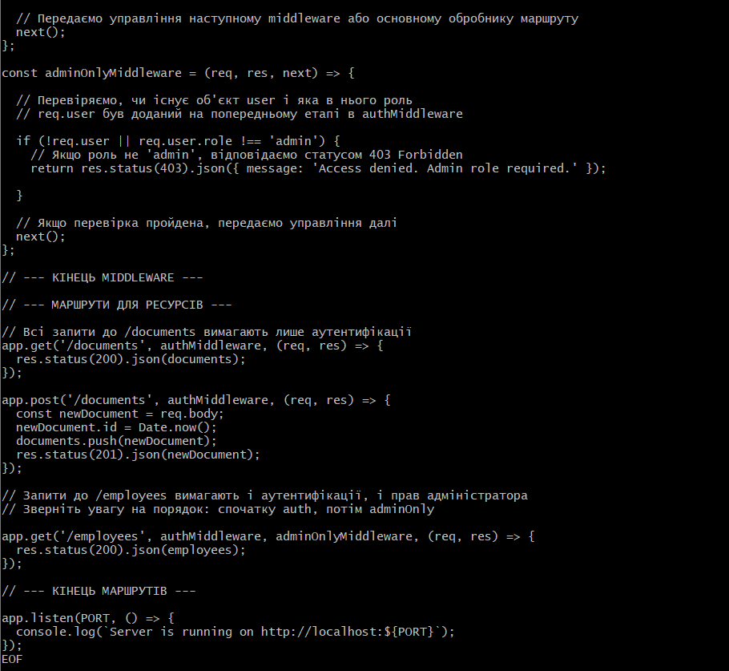

Запуск сервера:

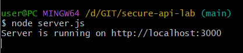

---

3. Перевірка роботи логера

   Перезапущено сервер (`node server.js`). Відкрито Postman і надіслано 2 запити, які вже були протестовані на попередньому етапі.

   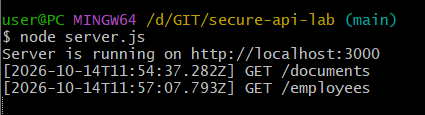

   Скріншот підтверджує, що middleware для логування успішно перехоплює та реєструє всі вхідні запити.

---

4. Збереження результатів у Git

   Зроблено фінальний коміт перед комплексним тестуванням.

   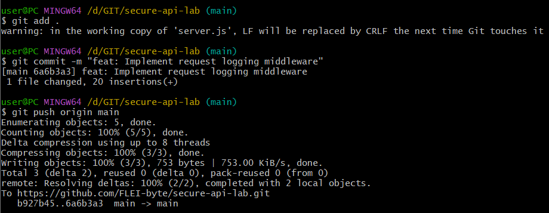

**Результат етапу:** сервер тепер і захищений, і веде журнал усіх звернень.

---

## Етап 5. Комплексне тестування

1. Доопрацювання сервера для повноцінного тестування

   Оновлено маршрут `POST /documents` та додано новий маршрут `DELETE /documents/:id` у файлі `server.js`. Запущено сервер:

   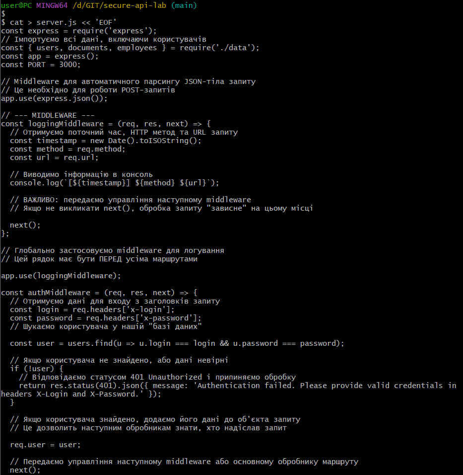

   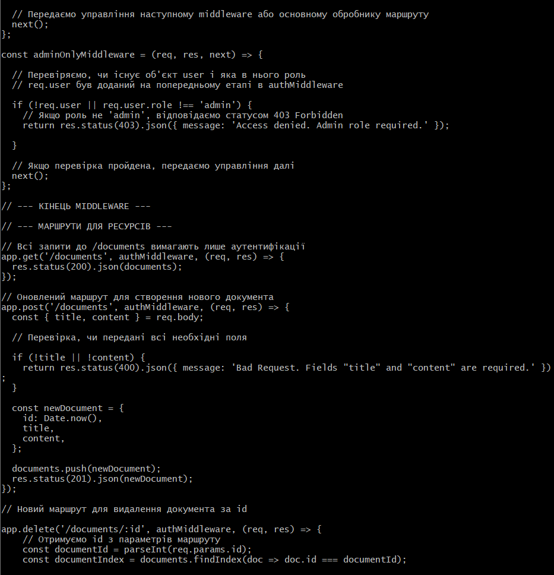

   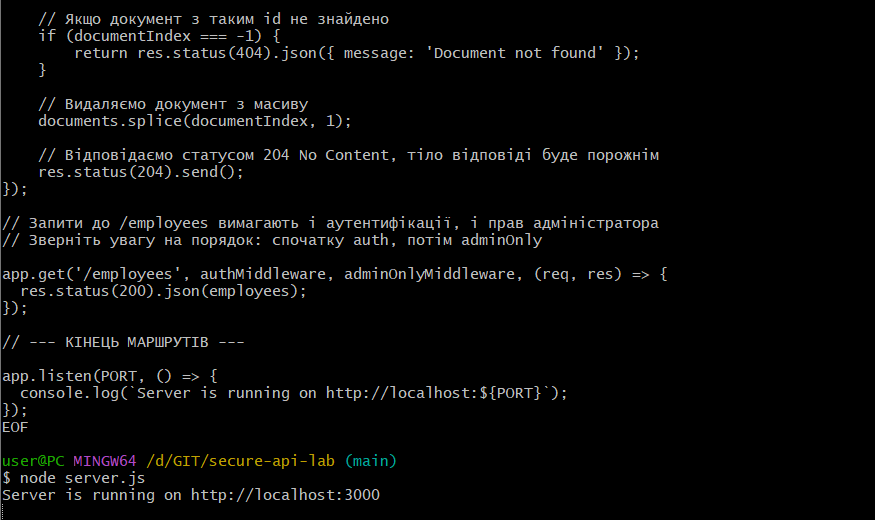

---

2. Тестування з рядка браузера

   Відкрито браузер і виконано перехід за адресою http://localhost:3000/documents.

   Сторінка відобразила помилку: `{"message":"Authentication failed. Please provide valid credentials in headers X-Login and X-Password"}`.

   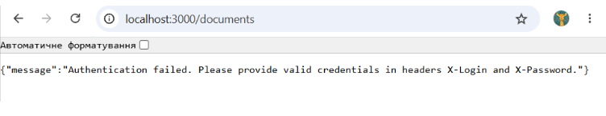

   В інструментах розробника (F12) на вкладці "Мережа" видно, що сервер повернув статус 401 Unauthorized.

   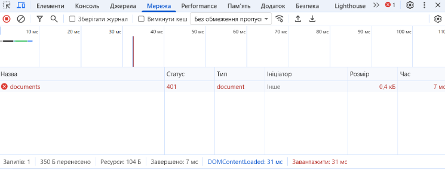

---

3. Тестування за допомогою Postman

   Створено у Postman колекцію запитів для перевірки всіх можливих сценаріїв.

   **3.1**

   | Метод | URL | Headers | Body | Очікуваний статус | Примітка |
   | :---: | :--- | :--- | :--- | :---: | :--- |
   | GET | `/documents` | - | - | 401 Unauthorized | Спроба доступу без автентифікації |

   

   **3.2**

   | Метод | URL | Headers | Body | Очікуваний статус | Примітка |
   | :---: | :--- | :--- | :--- | :---: | :--- |
   | GET | `/employees` | `X-Login: user1`, `X-Password: password123` | - | 403 Forbidden | Спроба доступу до адмін-ресурсу з роллю user |

   

   **3.3**

   | Метод | URL | Headers | Body | Очікуваний статус | Примітка |
   | :---: | :--- | :--- | :--- | :---: | :--- |
   | GET | `/documents` | `X-Login: user1`, `X-Password: password123` | - | 200 OK | Успішне отримання даних з роллю user |

   

   **3.4**

   | Метод | URL | Headers | Body | Очікуваний статус | Примітка |
   | :---: | :--- | :--- | :--- | :---: | :--- |
   | GET | `/employees` | `X-Login: admin1`, `X-Password: password123` | - | 200 OK | Успішне отримання даних з роллю admin |

   

   **3.5**

   | Метод | URL | Headers | Body | Очікуваний статус | Примітка |
   | :---: | :--- | :--- | :--- | :---: | :--- |
   | POST | `/documents` | `X-Login: user1`, `X-Password: password123` | `{ "title": "Test Doc", "content": "..." }` | 201 Created | Успішне створення ресурсу |

   

   **3.6**

   | Метод | URL | Headers | Body | Очікуваний статус | Примітка |
   | :---: | :--- | :--- | :--- | :---: | :--- |
   | POST | `/documents` | `X-Login: user1`, `X-Password: password123` | `{ "content": "..." }` | 400 Bad Request | Помилка валідації (відсутнє поле title) |

   

   **3.7**

   | Метод | URL | Headers | Body | Очікуваний статус | Примітка |
   | :---: | :--- | :--- | :--- | :---: | :--- |
   | DELETE | `/documents/1` | `X-Login: admin1`, `X-Password: password123` | - | 204 No Content | Успішне видалення. Відповідь не має тіла |

   

   **3.8**

   | Метод | URL | Headers | Body | Очікуваний статус | Примітка |
   | :---: | :--- | :--- | :--- | :---: | :--- |
   | GET | `/non-existent` | `X-Login: admin1`, `X-Password: password123` | - | 404 Not Found | Звернення до неіснуючого маршруту |

   

---

4. Тестування за допомогою Node.js скрипта

   Створено у проєкті новий файл `test-client.js` та додано до нього наступний код:

   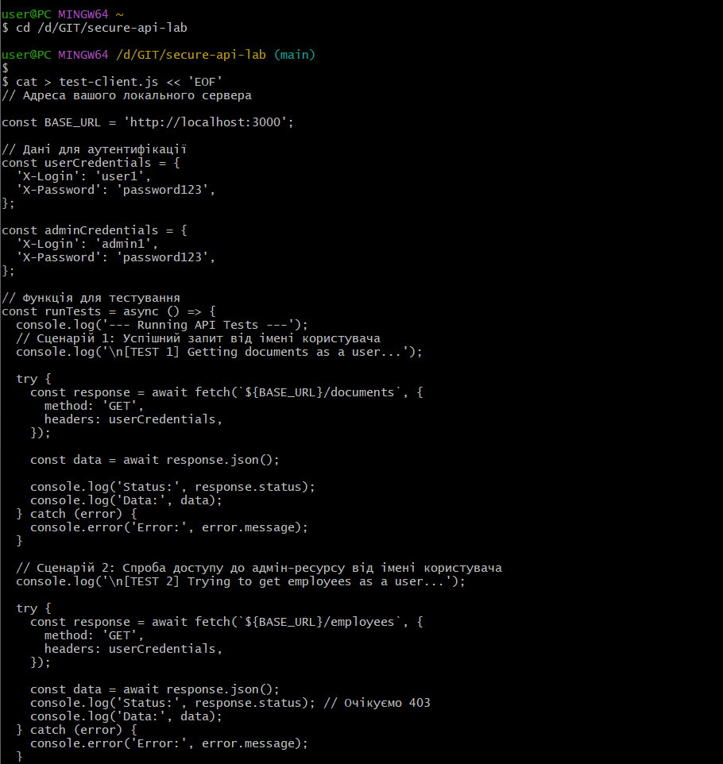

   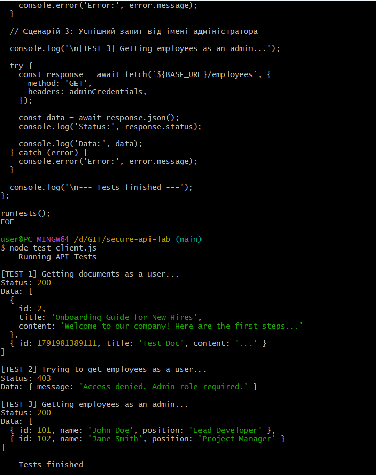

   У новому терміналі, не закриваючи той, де працює сервер, виконано команду `node test-client.js`. У підсумку відбулися 3 тести зі статусами 200, 403, 200.

   Аналіз виводу `node test-client.js`:

   | Тест | Запит | Статус | Опис |
   | :---: | :--- | :---: | :--- |
   | 1 | GET `/documents` від user1 | 200 | Аутентифікація пройшла (логін і пароль коректні), `authMiddleware` пропустив запит, документи повернулись |
   | 2 | GET `/employees` від user1 | 403 | Користувач аутентифікований, але має роль user, а не admin. `adminOnlyMiddleware` відмовив: це авторизація |
   | 3 | GET `/employees` від admin1 | 200 | Роль admin пройшла обидві перевірки, конфіденційні дані повернулись |

---

5. Фінальний коміт

   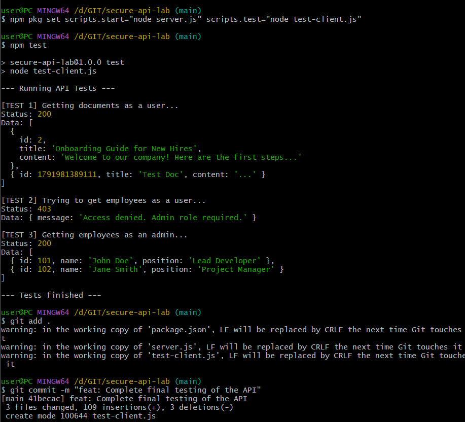

   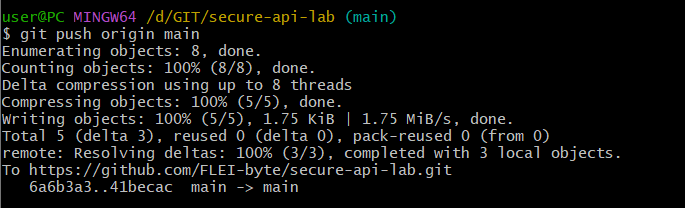

---

## Висновок

У ході роботи розроблено REST API на Node.js та Express і реалізовано його захист за допомогою middleware: authMiddleware для аутентифікації та adminOnlyMiddleware для авторизації за роллю. Також додано логування запитів. Комплексне тестування через браузер, Postman і скрипт test-client.js підтвердило, що сервер повертає очікувані статуси (200, 201, 204, 400, 401, 403, 404). Отримано практичні навички створення, захисту й тестування серверних додатків, а результати кожного етапу збережено в Git.
